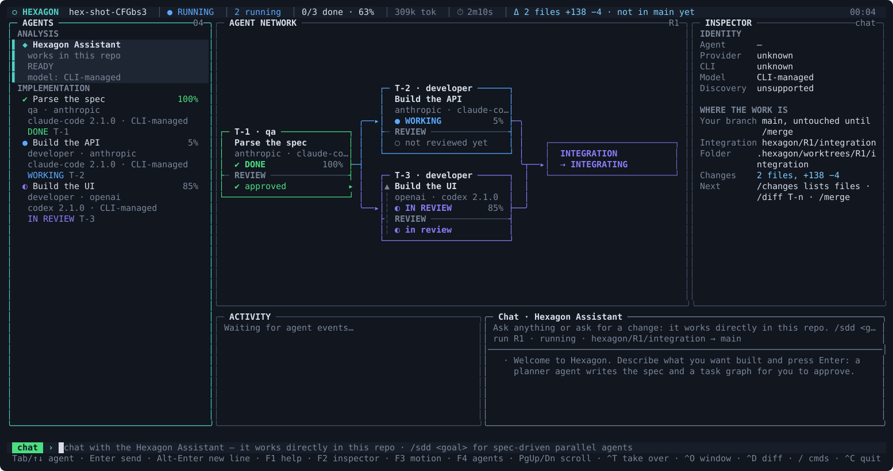
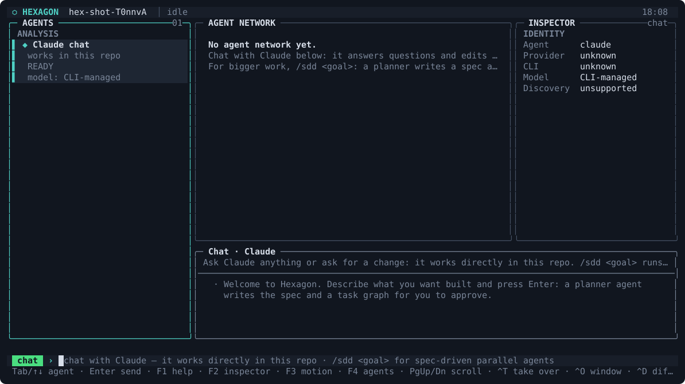
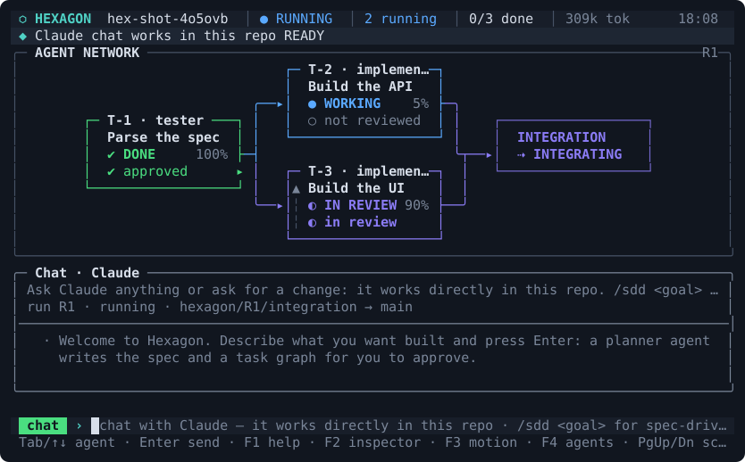
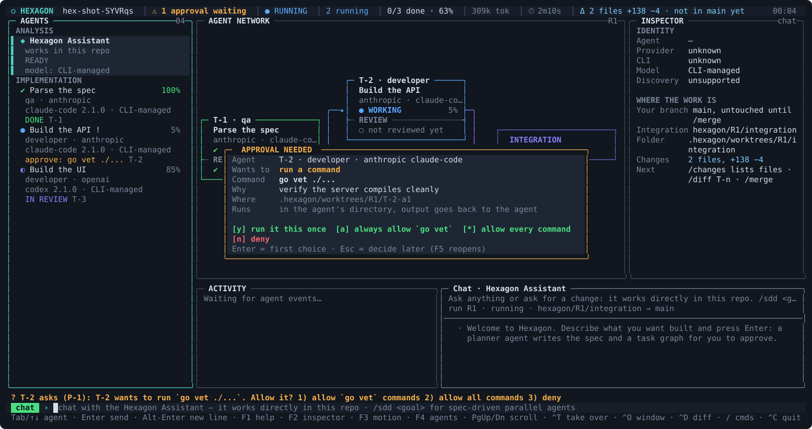
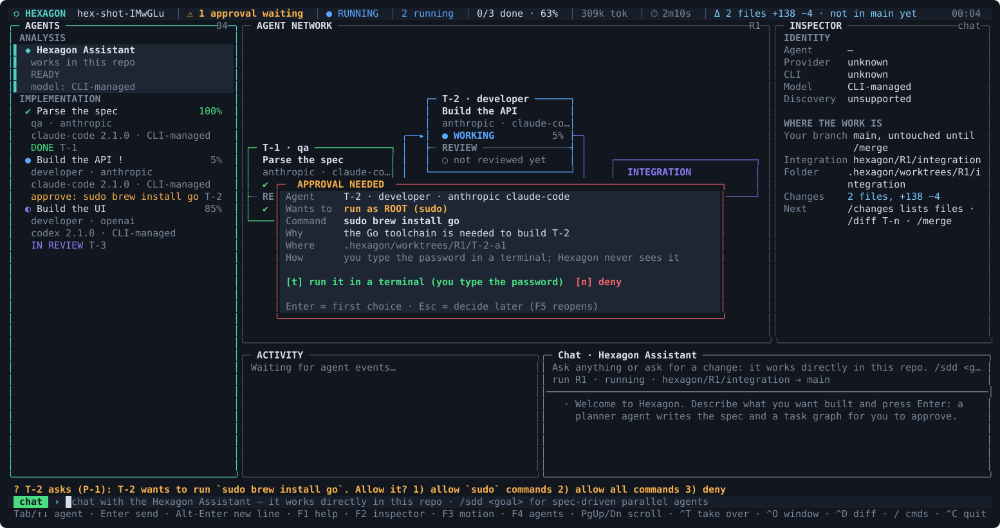

# Hexagon

A terminal dashboard that runs several coding agents in parallel on one goal. The agents are
Claude Code (or any other coding CLI), each in its own git worktree.

- **Chat with Claude by default.** Ask questions or ask for changes; Claude works directly
  in your repository, like Claude Code.
- **Spec-driven development when you want it.** `/sdd <goal>`: a planner agent writes a
  short spec and a task graph, and you approve it with Enter (or say what to change).
  Agents then implement the tasks in parallel. Hexagon re-runs each task's verify commands,
  a reviewer agent checks the diff, and the work is merged into an integration branch.
  `/merge` brings it into your branch.
- **Wraps agent CLIs, no API integration.** Each agent is a real `claude -p` session
  (stream-json), so it uses your Claude Code login, tools, CLAUDE.md and settings. Agents
  report back by running plain shell commands (`hexagon report|ask|note|done`). Any other
  non-interactive CLI can be plugged in with `adapter = "exec"`.
- **See everything.** A full-screen dashboard shows:
  - a live **agent network**: square cards joined by orthogonal edges, each with its own review
    footer (not reviewed / in review / changes requested / approved) and an integration hub, animated only by real events (see [docs/TUI.md](docs/TUI.md));
  - an **agent navigator** grouped by role (analysis, implementation, review, integration)
    with provider, CLI, version, model, state and progress, plus an inspector and an
    activity timeline;
  - a **chat with the selected agent**: its replies, your messages (✓ once received),
    Hexagon's instructions, and its tool steps folded into compact lines.
- **Agents can ask you for things.** A tool is missing, a command is not allowed, or root
  is needed: the agent runs `hexagon exec | install | sudo`, an **approval dialog** opens in
  the dashboard, and the same session continues the moment you answer. No restarts.
  Sudo passwords are typed by you in a real terminal; Hexagon never sees them.
- **Know where the work is.** The header shows what is not in your branch yet, the inspector
  lists branch and folder per agent, and `/changes` lists every changed file.
- **Steer and take over.** Message any agent mid-task, answer its questions, pause it, or
  take over: you land in the same Claude Code conversation (`claude --resume`) in its
  worktree, and hand it back when you're done.
- **`hexagon init` runs an agent.** It studies the repository (or asks what you're
  building) and writes `HEXAGON.md`, the brief every agent reads first.
- **Status contract.** Every agent publishes a schema-validated `status.json`, so scripts
  can follow along too. Metrics are local and personal; nothing is exported.

## Contents

[Quick start](#quick-start) · [The dashboard](#the-dashboard-ui-components) · [Keys](#keyboard) · [Commands](#command-reference) ·
[Adding another CLI](#adding-another-coding-cli) · [Approvals, tools and sudo](#approvals-tools-and-sudo) · [Where things live](#where-things-live) · [Configuration](#configuration) ·
[A full session](#a-full-session-start-to-finish) · [How it works](#how-it-works) · [Troubleshooting](#troubleshooting) · [Docs](#docs)

## Quick start

**1. Requirements.** git, and a coding agent CLI that is logged in: [Claude Code](https://claude.com/claude-code)
(`claude` on your PATH) is the default. Building from source needs Node ≥ 22; the installed binary does not.

**2. Install.**

```bash
git clone git@github.com:t1menar/hexagon.git && cd hexagon
npm install && npm run install:bin      # standalone binary → ~/.local/bin/hexagon
hexagon --version                       # make sure ~/.local/bin is on your PATH
```

After you change the source, run `npm run install:bin` again: `npm run build` only updates `dist/`, not the binary on your PATH.

**3. Set up a project.**

```bash
cd ~/projects/your-repo                 # any folder; Hexagon runs `git init` if needed
hexagon init                            # creates .hexagon/, lets an agent write HEXAGON.md
hexagon agents doctor                   # are the CLIs installed and logged in?
```

**4. Open the dashboard and work.**

```bash
hexagon
```

| You want | You type |
|---|---|
| a question answered, or a small change made directly in your repo | just type on the `claude` tab |
| a bigger goal split into parallel tasks | `/sdd add a /health endpoint and tests` |
| to approve the plan the planner drafted | **Enter** on an empty input (or `/run`) |
| to see where the changes are | `/changes` |
| to bring the finished work into your branch | `/merge` |
| to leave (agents keep working in the background) | `Ctrl-C` twice, or `/quit` |

Try everything offline and free: set `agent = "mock"` for every role in `.hexagon/config.toml`.



*(Screenshots in this README are generated from the real renderer by `npx tsx scripts/screens.ts`.)*

## The dashboard: UI components



| # | Component | What it shows and how to use it |
|---|---|---|
| 1 | **Header** | Project, run state (`● RUNNING`), counts (`2 running`, `0/3 done`), tokens, elapsed time, provider health (`anthropic ✔`), `Δ N files +x −y · not in main yet` (what the run changed and has not reached your branch), `⚠ N approvals waiting`. |
| 2 | **Agents (navigator)** | Left column, grouped by lifecycle: ANALYSIS (chat, planner, init), IMPLEMENTATION, REVIEW, INTEGRATION. Each agent has a state glyph, progress, role, provider, CLI version and model. `Tab` / `↑↓` select. The selected agent decides what the chat, inspector and network highlight. |
| 3 | **Agent network** | Middle top. One square card per task, joined by orthogonal edges that follow the task dependencies, and an `INTEGRATION` hub that closes the graph. Particles run along the real edge when an agent starts, finishes or is rejected. The footer of each card is its review: `○ not reviewed yet` · `◐ in review` · `↩ changes requested (fix N)` · `✔ approved`. A rejection runs up the rail on the left side of the card (`▲ REJECTED → developer`); an approval leaves through the right side (`✔ APPROVED → integration`). On a graph too large for the box you get `+N more agents not shown`. |
| 4 | **Empty state** | With no network yet, the pane explains the two ways to start: type to chat with Claude, or `/sdd <goal>`. Nothing animates there. |
| 5 | **Inspector** (`F2`) | Right column. For the chat: identity, and **WHERE THE WORK IS** (your branch, integration branch, folder, size, next step). For a task agent: identity, session tokens, **WORKSPACE** (folder, branch, files changed). |
| 6 | **Activity** | A timeline of real events: starts, reviews, rejections, approvals, quota waits, recoveries. |
| 7 | **Chat** | The conversation with the selected agent: its replies, your messages (`✓` when received), Hexagon's notes and its tool steps folded into compact lines. `PgUp/PgDn` scroll. |
| 8 | **Input** | The coloured chip names who receives your text (`chat`, `T-2`, `answer Q-1`). `/` opens commands, `@` mentions, `Tab` or `→` completes. |
| 9 | **Shortcut bar** | Always on the last row. |
| 10 | **Approval dialog** | Opens by itself when an agent needs a decision (see below). |



**Layouts.** The dashboard adapts to the terminal: **large** (≥150×30: navigator, network, inspector, activity, chat), **medium** (≥100×22: narrower navigator, the inspector is optional) and **small** (a strip instead of the navigator). The inspector opens only if the network keeps room. Any size ≥ 40×16 stays readable and never overflows.

**Motion.** Animation is driven only by real events and by one ambient effect (a faint hexagon background). `/animate full|reduced|off` or `F3` changes it; the default (`auto`) is calm: `reduced` (8 fps, no background layer). Full motion (15 fps, particles, background hexagons) is opt-in with `/animate full`, `[ui] animation = "full"` or `HEXAGON_ANIMATION=full`. `off` (static, nothing redraws when idle) with `NO_MOTION=1` or `HEXAGON_ANIMATION=off`. The startup animation (1.5 s) is skipped by any key or `HEXAGON_STARTUP=off`. Design notes: [docs/TUI.md](docs/TUI.md); a text gallery of every state: [docs/TUI-SNAPSHOTS.md](docs/TUI-SNAPSHOTS.md).

**Colour and glyphs.** Truecolor, 256, 16 or no colour is detected from the terminal (`NO_COLOR` respected); `HEXAGON_ASCII=1` forces plain ASCII borders and symbols.

### State glyphs

`○` queued · `◔` starting · `●` working · `?` needs you · `‖` paused · `◷` waiting for a provider limit · `◑` verifying · `◐` in review · `⇢` integrating · `✔` done · `✖` failed · `⊘` blocked · `−` cancelled.

## Keyboard

| Key | Action |
|---|---|
| typing + **Enter** | send to the agent named by the chip (the `claude` chat by default) |
| **Enter** on an empty input | approve the draft plan; in an approval dialog, pick the first choice |
| **Tab** / **↑ ↓** | next / previous agent |
| **PgUp / PgDn** | scroll the chat |
| **/** , **@** | command and mention suggestions (`Tab` or `→` completes) |
| **F1** | help (the command list) |
| **F2** | show or hide the inspector |
| **F3** | motion on / off |
| **F4** | agents, CLI versions, auth, models |
| **F5** | reopen an approval dialog you dismissed |
| **Esc** | in an approval dialog: decide later (it stays in the header as `⚠ N approvals waiting`) |
| **Ctrl-T** | take over the selected agent's session (you work in the same Claude conversation) |
| **Ctrl-O** | open the selected agent in a new terminal window |
| **Ctrl-D** | show the agent's diff |
| **Ctrl-C** twice | leave; the daemon and the agents keep running |

## Command reference

Hexagon has two surfaces: the **dashboard** (slash commands, type them in the input) and the **CLI** (`hexagon <command>`, works in any shell, also in scripts). Almost everything exists in both.

### Dashboard commands (slash)

| Command | What it does |
|---|---|
| `/sdd <goal>` | Spec-driven development: a planner agent writes `specs/<name>.spec.md` and a task graph; the result is a **draft** you approve. |
| `/run [-j N] [--agent X]` | Approve the draft and start the agents. `-j` limits parallelism; `--agent` uses one agent for every role (e.g. `mock`). |
| `/discard` | Throw the draft away. |
| `/spec`, `/plan` | Open the spec or the draft `plan.json` in `$EDITOR`. |
| `/init [description]` | An agent studies the repository and writes `HEXAGON.md`. |
| `/lead <question>` | Ask the Claude chat (same as typing on the `claude` tab). |
| `/tell <T-n\|@role\|@all> <text>` | Message agents; the text arrives at their next step. |
| `/answer <Q-n> <text>` | Answer an agent's question (an option number works). |
| `/pause [T-n]`, `/resume [T-n]`, `/cancel [T-n]` | Control one agent, or the whole run when no task is given. |
| `/retry [T-n] [--agent X] [--effort E]` | Start a new attempt, optionally with another agent or effort (`low`, `medium`, `high`). |
| `/takeover [T-n]` | Work in the agent's own session yourself (`Ctrl-T`). Exit to hand it back. |
| `/open [T-n]` | Open the agent in a new terminal window (`Ctrl-O`). |
| `/diff [T-n]` | The agent's changes (`Ctrl-D`). |
| `/changes` | **Where the work is**: your branch, integration branch, folders, number of files and lines, up to 40 changed files, and each agent's worktree and branch. |
| `/merge` | Merge the finished run's integration branch into your branch. |
| `/abort` | Stop the run. |
| `/clean` | Remove the worktrees of finished runs (and close the run). |
| `/close` | Hide a finished run from the dashboard without merging it. |
| `/model [role] [model\|default]` | Show or set a model override per role. `default` returns to the CLI's own model. |
| `/agents` | Agents, providers, CLI versions, auth and what each CLI reports about models (`F4`). |
| `/allow <cmd…>\|all` | Let agents run these commands from now on (`/allow brew curl`, `/allow "git push"`), or everything. Saved to `.hexagon/local.toml`. |
| `/install <tool>` | Install `go`, `node`, `java` or `maven` for agents (official release into `~/.hexagon/toolchains`, no Homebrew, no sudo). |
| `/animate [full\|reduced\|off]` | Motion level (`F3` toggles). |
| `/stop` | Stop the daemon and every agent, then quit. |
| `/quit` | Leave; agents keep running. |
| `/help` | The command list (`F1`). |

### CLI commands

**Start**

| Command | What it does |
|---|---|
| `hexagon init ["what you are building"]` | Creates `.hexagon/` (config, roles, specs), makes sure git exists, and lets an agent write `HEXAGON.md`. An empty repository gets a stub. A folder that only *contains* repositories is refused (probably a missing `cd`) unless you pass `--here`. |
| `hexagon` (also `hexagon ui`, `hexagon shell`) | Opens the dashboard. Without a terminal it prints the status table. |
| `hexagon attach <T-n>` | Opens the dashboard with that agent selected. |
| `hexagon sdd "<goal>"` (alias `new`) | Starts the planner; the draft appears for approval. |
| `hexagon chat "<message>"` | Sends a message to the Claude chat; the reply shows in the dashboard. |
| `hexagon run [plan.json] [-j N] [--agent X] [--follow]` | Approves the draft (or runs a plan file) and, with `--follow`, streams the run. |

**Watch and steer**

| Command | What it does |
|---|---|
| `hexagon status [T-n] [--json]` | Table of agents, states and tokens, or one agent in detail. Works without the daemon (from the status files). |
| `hexagon tell <T-n\|@role\|@all> <text>` | Message agents, or continue a blocked one. |
| `hexagon answer <Q-n\|P-n> <text>` | Answer a question (`Q-1 2` picks option 2) or an approval (`P-1 1`). |
| `hexagon pause\|resume\|cancel <T-n>` | Control one agent. |
| `hexagon retry <T-n> [--agent X] [--effort E]` | New attempt. |
| `hexagon takeover <T-n>` | Continue the agent's own session yourself (`claude --resume`). |
| `hexagon open <T-n>` | Open the agent in a new terminal window. |
| `hexagon diff <T-n>`, `hexagon logs <T-n>` | The agent's changes and its event log. |
| `hexagon trace` | Requirement → task → agent → verification → review → completion. |
| `hexagon merge` | Integration branch → your branch. |
| `hexagon close`, `abort`, `clean` | Hide a finished run, stop the run, remove finished worktrees. |
| `hexagon up`, `hexagon down [--yes]` | Show or start the background daemon / stop it (asks first if agents are active). |
| `hexagon inbox` | Raw inbox of messages waiting for agents (JSON). |

**Configure**

| Command | What it does |
|---|---|
| `hexagon allow <cmd…>\|all` | Allow commands for agents (stored in the git-ignored `.hexagon/local.toml`). |
| `hexagon install [go\|node\|java\|maven]` | Install a toolchain for agents; without a name, list what is installed. |
| `hexagon model [role model\|default]` | Show or set a model override per role. |
| `hexagon agents [list]` | Configured agents, executables, versions, auth, capabilities. |
| `hexagon agents doctor` | Same, with diagnostics; exit code 1 if something needs attention. |
| `hexagon agents models <agent>` | Models the CLI reports, when it can. |
| `hexagon agents configure [role agent]` | Interactive role → agent → model wizard, or set one role directly. |
| `hexagon agents add <id> <adapter> [--provider P] [--command bin]` | Register another agent CLI (`claude-code`, `codex`, `grok`, `exec`, `mock`). |

**Agent protocol.** These run *inside* agent sessions; you rarely type them. They are how agents talk to Hexagon (each is a plain shell command):

| Command | Purpose |
|---|---|
| `hexagon report "<activity>" [--phase P] [--done AC-1 …]` | progress and acceptance criteria met |
| `hexagon ask "<question>" [--option "…"] [--default "…"]` | a question for you (blocking ones are limited) |
| `hexagon note "<fact>"` | a fact for other agents |
| `hexagon return <T-n> "<defect>"` | report a defect in another task's code instead of editing it |
| `hexagon done --summary "…" [--evidence "AC-1: …"] [--status completed\|blocked\|failed\|needs_spec_change]` | finish the task |
| `hexagon review approve\|changes --summary "…" [--finding "high: file:line issue -> fix"]` | the reviewer's verdict |
| `hexagon plan-check` | validate the plan |
| `hexagon exec [--reason "why"] -- <command…>` (or `--shell "a && b"`) | run a command that is not allowed yet, **after you approve it** |
| `hexagon install <tool> [--reason "why"]` | ask you to install a toolchain |
| `hexagon sudo [--reason "why"] -- <command…>` | ask you to run a root command in your own terminal |

## Adding another coding CLI

Hexagon wraps coding CLIs, it does not call model APIs. Any CLI that can run **non-interactively** (takes a prompt, works in the current folder, can run shell commands) can serve a role. Pick the path that fits; paths 1 and 2 need no code.

**Requirements for any CLI:** it runs in a git worktree as its working directory, it can execute shell commands (agents report back with `hexagon report | done | …`, which Hexagon puts on its PATH), and it is already logged in on your machine.

### Path 1: a built-in adapter (Claude Code, Codex, Grok)

```bash
hexagon agents add codex codex --provider openai      # id, adapter, optional provider / --command
hexagon agents doctor                                 # installed? logged in? what it can enforce
hexagon agents configure reviewer codex               # role → agent (or run it without arguments for the menu)
```

This writes `[agents.codex]` to `.hexagon/config.toml`. The Codex and Grok integrations follow the vendors' public CLI docs and are tested with mock CLIs, not the real ones: check them with `hexagon agents doctor` and one small task before relying on them ([docs/PROVIDERS.md](docs/PROVIDERS.md)).

### Path 2: any other CLI with the generic `exec` adapter (config only)

Add it to `.hexagon/config.toml`. `{prompt}` is replaced by the task prompt (system instructions + task); without it the prompt is appended as the last argument.

```toml
[agents.gemini]
adapter  = "exec"
provider = "google"
command  = ["gemini", "-p", "{prompt}"]      # your CLI's non-interactive flag
# interactive = ["gemini"]                   # optional: what Ctrl-T (takeover) should open

[roles.implementer]
agent = "gemini"                             # use it for implementers; other roles keep their agent
```

Check and try it:

```bash
hexagon agents doctor                        # finds the executable and version
hexagon run plan.json --agent gemini         # or /run --agent gemini: every role uses it, for a first test
```

The generic adapter claims nothing it cannot verify: no live messages while it runs (they arrive on the next run), no session resume, no model discovery, no token usage (the dashboard shows "CLI-managed"). It cannot enforce read-only, so a **reviewer** on it is refused unless you accept that with `allow_weaker_isolation = true` under that agent. Provider limits are detected from the CLI's output text and waited out like any other.

### Path 3: a full adapter (streaming, resume, models)

If the CLI streams JSON events, has session resume or lists models, write a small adapter class (about 100 lines) and register it with `registerAdapter("acme", …)`. The step-by-step guide with a tested example is [docs/ADDING_PROVIDER.md](docs/ADDING_PROVIDER.md): choose a base class, map the CLI's events to chat, tool and usage events, report only the capabilities you verified, and test it against a fake CLI script.

### Choosing which agent does what

```toml
[roles.planner]
agent = "claude"                              # one agent per role

[roles.implementer]
agent = "gemini"

[roles.reviewer]
agent = "claude"
fallback_agent = "gemini"                     # used only with [recovery] allow_provider_failover = true
```

`/model <role> <identifier|default>` overrides a model for a role (an opaque string handed to the CLI; `default` returns to the CLI's own). `hexagon agents models <agent>` lists models only when that CLI can.

## Approvals, tools and sudo

Agents run with a limited command list (`[sandbox].allow_commands`). When one needs more, it does **not** stop and it does **not** restart: it calls the **command broker** and waits for you.



1. The agent runs `hexagon exec -- go vet ./...` (or `install go`, or `sudo …`).
2. A dialog opens over the dashboard with the exact command, who asks, why, and the folder it will run in. The header shows `⚠ N approvals waiting`.
3. You choose. The dashboard answers the daemon, the daemon runs the command and hands the output (or the denial) back to the **same agent session**. It continues where it was.

| Choice (key) | Effect |
|---|---|
| **run it this once** (`y`) | runs now, nothing is remembered |
| **always allow `<prefix>`** (`a`) | runs now and allows that command prefix from now on |
| **allow every command** (`*`) | runs now and allows everything (`["*"]`) |
| **deny** (`n`) | the agent gets a refusal and adapts |

`Enter` takes the first choice, `Esc` postpones (`F5` reopens), a number also works. Unanswered requests are denied after 30 minutes. From a shell: `hexagon answer P-1 1`.

**Missing toolchains.** At the start of a run Hexagon checks which toolchains the plan's stack needs and offers to install the missing ones (`go`, `node`, `java`, `maven`) as official releases into `~/.hexagon/toolchains`; no Homebrew and no sudo. Agents get them on their PATH.



**Sudo.** A root command is never run for you and **Hexagon never sees your password**. Pick *run it in a terminal*: Hexagon writes a small script and opens it in a real terminal window; you type the password there, and the exit code and output are returned to the waiting agent.

**Compound commands** (`a && b`, pipes) cannot be approved by prefix; they need `allow all` or the `--shell` form, which you approve explicitly.

**Personal approvals stay personal.** "Always" and "all" answers are written to `.hexagon/local.toml`, which is added to `.git/info/exclude`, so your approvals never end up in the committed `config.toml`.

## Where things live

| What | Where |
|---|---|
| Project config (commit it) | `.hexagon/config.toml` |
| Your own approvals (git-ignored) | `.hexagon/local.toml` |
| Specs | `specs/<name>.spec.md` |
| The brief every agent reads first | `HEXAGON.md` |
| Each agent's working copy | `.hexagon/worktrees/<run>/T-n-aN` on branch `hexagon/<run>/T-n-aN` |
| Where finished tasks are merged | `.hexagon/worktrees/<run>/integration` on `hexagon/<run>/integration` |
| Your branch | untouched until `/merge` |
| Agent status, events, results | `.hexagon/runs/<run>/…` (`status.json` per agent, schema-validated) |
| Toolchains installed by Hexagon | `~/.hexagon/toolchains` |

Inside the dashboard the inspector (**WHERE THE WORK IS** / **WORKSPACE**) and `/changes` show exactly these paths for the current run.

## Configuration

`hexagon init` writes a commented `.hexagon/config.toml`; the defaults are in [templates/config.toml](templates/config.toml).

| Section | Keys |
|---|---|
| `[run]` | `max_parallel`, `max_attempts`, `fix_loops`, `max_fix_cycles`, `max_identical_failures`, `budget_tokens`, `base_branch` |
| `[roles.<role>]` | `agent`, `effort`, optional `model`, `fallback_agent` for `init`, `planner`, `implementer`, `tester`, `reviewer`, `lead` |
| `[agents.<id>]` | `adapter` (`claude-code`, `codex`, `grok`, `exec`, `mock`), `provider`, `command`, `args`, `model` |
| `[recovery]` | provider-limit handling: `auto_resume`, backoff, `allow_provider_failover`, … ([docs/RECOVERY.md](docs/RECOVERY.md)) |
| `[review]` | `mode = "agent" \| "off"` |
| `[messaging]` | limits for agent-to-user messages |
| `[sandbox]` | `allow_commands`, `command_timeout_s` |
| `[ui]` | `open_with`, `animation`, `startup_animation`, `inspector`, `ambient` |

| Environment | Effect |
|---|---|
| `HEXAGON_ANIMATION=full\|reduced\|off`, `NO_MOTION=1` | motion level (default `auto` = reduced) |
| `HEXAGON_AMBIENT=off` | no background hexagons |
| `HEXAGON_STARTUP=off` | skip the startup animation |
| `HEXAGON_ASCII=1`, `NO_COLOR=1` | plain glyphs / no colour |
| `HEXAGON_CELL_ASPECT=2.0` | cell height ÷ width, for the hexagon geometry |

## A full session, start to finish

This builds a small Java service from an empty folder. The same steps work in an
existing repository; `hexagon init` then studies the code instead of writing a stub.

**1. Set up the project.**

```bash
brew install openjdk@21 maven        # the tools your project needs, so agents can build and test
mkdir ~/projects/hello && cd ~/projects/hello
hexagon init
```

```
✔ created .hexagon/config.toml, .hexagon/roles/…, specs, .gitignore (updated)
✔ initialized a git repository and made the initial commit (agents work in git worktrees)
✔ empty repository: wrote a stub HEXAGON.md (filled in as code lands)
```

Hexagon never asks what you're building. An empty repo gets a stub brief, and whoever
writes the first code fills it in. If you already know the stack, say it up front:
`hexagon init "Spring Boot 3 REST service, Java 21, Maven"`.

**2. Small changes: just chat.** Run `hexagon` and type on the `claude` tab:

```
› you      Create a Spring Boot 3 project with Maven: GET /hello?name=X returns "Hello, X!"
           (default World), with a MockMvc test. Update HEXAGON.md with the commands.
◆ claude   Created pom.xml, HelloApplication, HelloController and HelloControllerTest;
           filled in HEXAGON.md. `mvn -q test` passes (2 tests).
           ⌁ 18k in · 1.2k out
```

Claude works directly in the repository, like Claude Code. Review the change with
`git diff`, then commit it yourself.

**3. Bigger work: spec-driven development.** Use it when a goal splits into parts that
agents can build in parallel:

```
/sdd Add a /greetings REST resource (CRUD, in-memory store), input validation with
     400 errors, and a README section on how to run it
```

- The planner (`planner` tab) writes `specs/<name>.spec.md` (requirements with acceptance
  criteria) and a task graph. The graph appears at the top as a **draft plan**.
- Read it with `/spec` and `/plan`. To change it, type feedback on the `planner` tab
  ("merge T-3 into T-2"). The planner revises the draft.
- Press **Enter** on an empty input (or `/run`) to approve it. You can also limit
  parallelism with `/run -j 2`.

**4. Watch and steer the run.**

- **The network:** each task is a square card joined by edges that follow the dependencies;
  working agents get a moving highlight, particles run along the real edge when work moves,
  and each card's footer shows its review verdict (see [the dashboard](#the-dashboard-ui-components)).
- **Agents list:** one entry per agent: task name, progress, role, provider, CLI version and
  state. Tab or ↑↓ selects an agent, and the chat shows your conversation with it.
- **Where is it?** The header chip `Δ N files … not in main yet` and `/changes` show what the
  run changed; the inspector gives each agent's folder and branch.
- **Message an agent:** type while it works ("use records for DTOs"). The message
  arrives at its next step and shows `✓ received`.
- **Questions:** an agent may ask one (`? Q-1 …`, the chip says `answer Q-1`). Type the
  answer, or an option number.
- **Do it yourself:** Ctrl-T takes over the agent's Claude session in its worktree. Exit
  it to hand the task back.

**Areas of responsibility.** Each task owns its write scope, and every agent sees which
task owns what. Suppose an agent finds a defect in another task's code, e.g. the tester
finds a bug in T-1's handler. It doesn't fix it; it runs
`hexagon return T-1 "<what's wrong, with evidence>"`. Then:
- T-1's agent is reopened in its own session with the report.
- T-1's fix goes through verify, review and merge again.
- The returning agent waits, gets the fix merged into its worktree, and carries on.

**5. When an agent gets stuck.** An agent that can't finish (a missing tool, an unclear
spec) stops as `⊘ blocked` and explains why in its chat. Fix the cause, then reply on its
tab:

```
continue T-2  › maven is installed now, run the tests again
```

It continues in the same session and worktree. `/retry T-2` instead starts a fresh
attempt, optionally with `--effort high` or `--agent <other>`.

**Missing tools.** If agents need a toolchain that isn't installed, Hexagon asks at the start of
the run, or an agent asks through `hexagon install`. You can also run `/install go` (also
`node`, `java`, `maven`): it downloads the official release into `~/.hexagon/toolchains`,
without Homebrew or sudo. Agents and verify commands get it on their PATH, and the agents
that were waiting continue in the same session. See [Approvals, tools and sudo](#approvals-tools-and-sudo).

**Agents, providers and models.** Each role is served by an *agent*: a provider's coding CLI
(`claude-code`, `codex`, `grok`, any `exec` wrapper, or your own adapter). Hexagon ships **no model
names**. Unless you override one, every CLI keeps using its own configured default, and the dashboard
shows the model the running process *reports* (or "CLI-managed" when it does not say).
`hexagon agents list|doctor` shows executables, versions, auth and capabilities;
`hexagon agents models <agent>` lists models only when that CLI can; `hexagon agents configure`
walks through role → agent → model; `/model <role> <identifier|default>` sets or clears an opaque override.
See [docs/PROVIDERS.md](docs/PROVIDERS.md).

**Provider limits don't fail tasks.** Rate limits, usage quotas, context overflow and truncated output
are classified and handled separately; the task waits (`waiting_quota`) and resumes by itself, also after
a daemon restart. They never consume a fix cycle or an attempt. See [docs/RECOVERY.md](docs/RECOVERY.md).

**6. Merge.** Each finished task has passed verification and review and is already merged
into the run's integration branch, `hexagon/<run>/integration`. When the run ends:

```
/diff T-1              # any task's changes (or Ctrl-D)
/merge                 # merge the integration branch into your branch
```

Then run the tests once more on your branch and push. A merged run is closed and leaves
the dashboard. `/clean` removes its worktrees, and `/close` hides a finished run without
merging it.

**The same flow without the dashboard:**

```bash
hexagon chat "add a /health endpoint returning the git sha"   # direct change by Claude
hexagon sdd "greetings CRUD resource with validation"           # draft spec + task graph
hexagon run --follow                                           # approve and stream the run
hexagon status                                                 # table of agents, tokens, states
hexagon tell T-2 "maven is installed now, run the tests again" # message (or continue) an agent
hexagon answer Q-1 2                                           # answer a question
hexagon merge                                                  # integration branch → your branch
```

## How it works

```
goal ─▶ planner agent ─▶ specs/<name>.spec.md + task graph ─▶ you approve
     ─▶ for each ready task (deps, file leases, -j N): worktree from the integration branch
        ─▶ `claude -p` session implements it, runs `hexagon done`
        ─▶ out-of-scope edits reverted ─▶ commit ─▶ verify commands re-run ─▶ reviewer agent
        ─▶ merged into hexagon/<run>/integration
     ─▶ /merge into your branch
```

- Failed attempts are retried with more effort.
- A failed verify or review sends the agent back into the same session with the output.
- The run pauses when its token use reaches `[run].budget_tokens` (0 = no limit).

**Agent permissions:**
- Edits are auto-accepted inside the worktree.
- Shell commands are limited to `[sandbox].allow_commands` (Claude Code
  `--allowedTools "Bash(<prefix>:*)"`). `hexagon init` adds what your project needs.
- `["*"]` allows everything (bypass mode).
- **Approvals:** when an agent (or Claude in the chat) needs a command that is not allowed,
  it asks through `hexagon exec` and an approval dialog opens (details above). The same
  session continues as soon as you answer; nothing restarts. CLI: `hexagon answer P-1 1`.
- **Allow ahead of time:** `/allow brew curl` (or `/allow "git push"`) lets agents run
  those commands from now on. `/allow all` lets them run anything, including outside the
  project folder. Read-only probes (`which`, `command -v`, `go version`, `ls`, `cat`,
  `git status`…) are always allowed. When a compound command is refused, the approval
  covers just the refused part.
- Agents use the tools installed on your machine (`go`, `mvn`, `node`…). They never install
  toolchains behind your back: they ask (`hexagon install` / `hexagon sudo`) and you decide.

## Troubleshooting

| Symptom | Fix |
|---|---|
| "I don't see my changes when I run `hexagon`" | `npm run install:bin` rebuilds the binary on your PATH; `npm run build` only updates `dist/`. |
| `not inside a Hexagon project` | Run `hexagon init` in the repository first. |
| An agent is `⊘ blocked` | Read its chat, fix the cause (install a tool, approve a command), then reply on its tab: it continues in the same session. `/retry T-n` starts a fresh attempt instead. |
| Nothing happens after `/sdd` | `hexagon agents doctor`: is `claude` installed and logged in? |
| `waiting for a provider limit` | Nothing to do: it resumes by itself at the reset time ([docs/RECOVERY.md](docs/RECOVERY.md)). |
| Odd glyphs or broken borders | `HEXAGON_ASCII=1 hexagon`; check that the terminal uses a UTF-8 locale and a font with box-drawing and `⬢ ⬡`. |
| Edges or hexagons look stretched | Set `HEXAGON_CELL_ASPECT` to your cell height ÷ width (about 2.0). |
| Too much motion / slow over SSH | `/animate reduced` or `off`, or `[ui] animation = "off"`. |
| The daemon looks stuck | `hexagon down --yes`, then `hexagon`. |
| Where did my change go? | `/changes`, or `git log hexagon/<run>/integration`. Your branch changes only on `/merge`. |

## Docs

- [docs/ARCHITECTURE.md](docs/ARCHITECTURE.md): architecture and design
- [docs/PROVIDERS.md](docs/PROVIDERS.md): providers, model handling, configuration, implemented vs planned
- [docs/ADDING_PROVIDER.md](docs/ADDING_PROVIDER.md): integrate another CLI (with a tested example)
- [docs/RECOVERY.md](docs/RECOVERY.md): provider-limit recovery, fix cycles, restart behaviour
- [docs/COMMUNICATION.md](docs/COMMUNICATION.md): messaging, status contract, attach and takeover
- [schemas/](schemas/): JSON Schemas for agent status, messages, plans and results

## Development

Screenshots: `npx tsx scripts/screens.ts` (SVGs in `docs/img/`). Text gallery: `npx tsx scripts/tui-snapshots.ts`.

```bash
npm run install:bin   # build the standalone executable (Node SEA) and install it
npm run build         # tsc → dist/
npm test              # unit + end-to-end (mock agent, real git worktrees)
```
